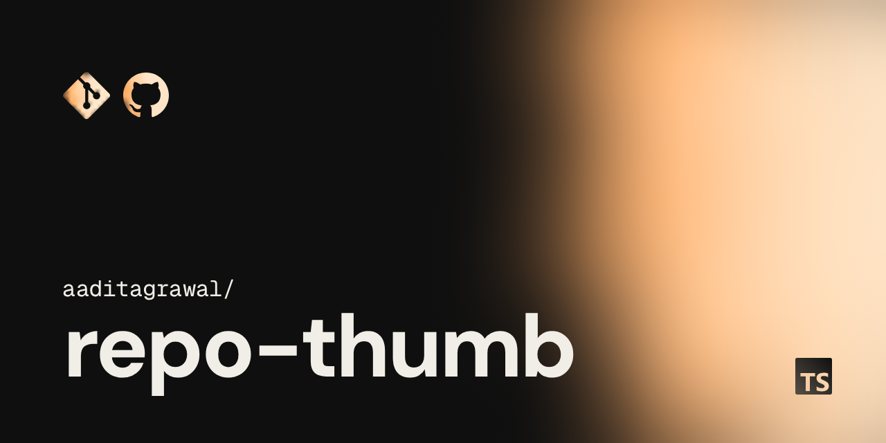
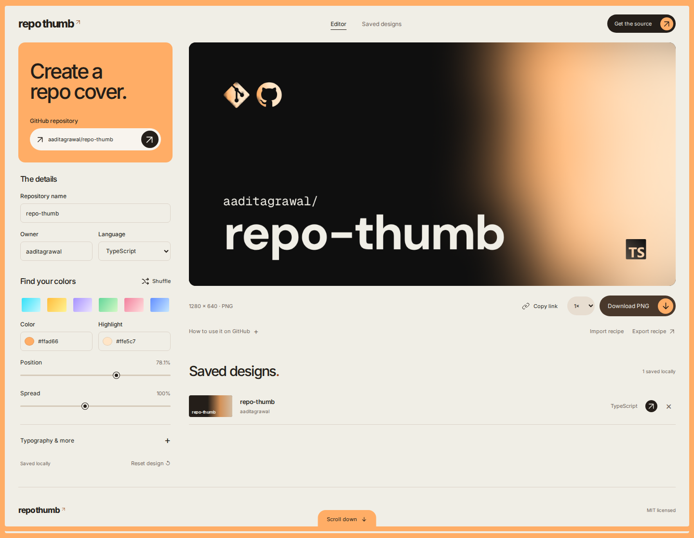

# Repo Thumb

Make GitHub repository covers in your browser. Paste a repository, tune the colors, and download a PNG.

[Open Repo Thumb](https://repothumb.coolstuff.work) · [Import the cover recipe](docs/assets/repo-thumb.json)

[](https://github.com/aaditagrawal/repo-thumb/actions/workflows/ci.yml)
[](LICENSE)

Repo Thumb draws each cover from a color mesh, local fonts, and vector logos. The Git and GitHub marks stay in place; the name, language, typography, and gradient are yours to change. There is no image-generation service or account to set up.



## Run locally

Install [Bun](https://bun.sh), version **1.4.4**, then:

```sh
git clone https://github.com/aaditagrawal/repo-thumb.git
cd repo-thumb
bun install --frozen-lockfile
bun run dev
```

Open the URL Vite prints. The server listens on `0.0.0.0` so you can also use it from another device on your network. Stop it with Ctrl+C.

## Make a cover

1. Enter `owner/repository` or paste a GitHub repository URL. Public repository names and languages load from GitHub.
2. Pick a preset, shuffle a new color combination, or set both colors yourself. Adjust the gradient's position and spread.
3. Edit the name and owner. Open **Typography & more** for fonts, tracking, background, text color, and logo visibility.
4. Download a PNG at **1280 × 640**, **2560 × 1280**, or **5120 × 2560**. The preview and download use the same renderer.

For GitHub, use the 1× image. Open your repository's **Settings → General → Social preview → Edit → Upload an image**.

The cover at the top of this README was made with the editor. [Import its recipe](docs/assets/repo-thumb.json) to reproduce it or use its colors as a starting point.

## Keep your designs

The editor saves up to 30 designs in your browser. Export a JSON recipe to keep a file you can import later, or use **Copy link** to share the complete design. Clearing browser storage removes locally saved designs, so export anything you want to keep.

Private repository details can be entered manually. GitHub lookup uses its unauthenticated public API, which has request limits. Lookup errors leave your current design intact and offer manual entry.

There is no backend, analytics, or token prompt. Fonts and logos ship with the app. Repository lookup is the only feature that contacts GitHub; editing and exporting do not need it. A shared design link includes the repository name and your design settings in its URL fragment.

## Development

The application is vanilla TypeScript and Canvas 2D, built with Vite. It has no runtime package dependencies.

```sh
bun run check          # TypeScript
bun test               # Unit tests
bun run format:check   # Prettier
bun run build          # Production site and portable source ZIP

# Install the test browser once:
bunx playwright install chromium --only-shell
bun run test:e2e       # Production UI, exports, storage, accessibility
bun run release:check  # All checks, build, browser tests, dependency audit
```

```text
src/
  main.ts           Editor events and render scheduling
  model.ts          Design schema, validation, palettes, title layout
  github.ts         Public repository lookup
  renderer.ts       Shared canvas preview and PNG export
  render/           Cached gradient rendering
  lib/              Saved designs and portable recipes
  ui/               DOM controls, library rows, scroll cue
scripts/            Source packaging, benchmarks, deployment checks
tests/e2e/          Desktop and mobile browser tests
public/             Local fonts, logos, licenses, security headers
```

Spatial weights and rendered backgrounds are cached independently, so changing text reuses the gradient. Input events share an animation-frame render, saved rows use small CSS swatches, and optional fonts load when selected. See the [architecture](docs/architecture.md) and [measured performance notes](docs/performance.md).

## Deploy

The hosted app uses Cloudflare Workers Static Assets at [repothumb.coolstuff.work](https://repothumb.coolstuff.work). Deployment uses the project-pinned Cloudflare CLI. See the [deployment guide](docs/deployment.md) for the commands and custom-domain configuration.

For other static hosts:

```sh
bun run build
```

Serve `dist/`. Netlify configuration is included; hosts supporting `_headers` also receive the cache and security policy in `public/_headers`.

For a repository subpath such as GitHub Pages:

```sh
BASE_PATH=/repo-thumb/ bun run build
```

`bun run preview` serves the production build locally. The **Get the source** button downloads a reproducible source ZIP assembled during the build. Dependencies, environment files, local deployment metadata, and generated artifacts are excluded.

CI checks pull requests and pushes; it does not deploy the site.

## Contributing

See [CONTRIBUTING.md](CONTRIBUTING.md). Bug reports and focused pull requests are welcome. Please include a screenshot for visual changes and a before/after image comparison for changes to the cover renderer.

Report vulnerabilities through [private security reporting](https://github.com/aaditagrawal/repo-thumb/security/advisories/new). See [SECURITY.md](SECURITY.md).

## License and credits

[MIT](LICENSE), by [Aadit Agrawal](https://github.com/aaditagrawal).

The cover layout began with the social preview for [fc-menu](https://github.com/aaditagrawal/fc-menu). DM Sans, Geist, Geist Mono, and Inter retain their SIL Open Font Licenses. Logo assets retain their original licenses and trademark ownership. See [THIRD_PARTY_NOTICES.md](THIRD_PARTY_NOTICES.md).
